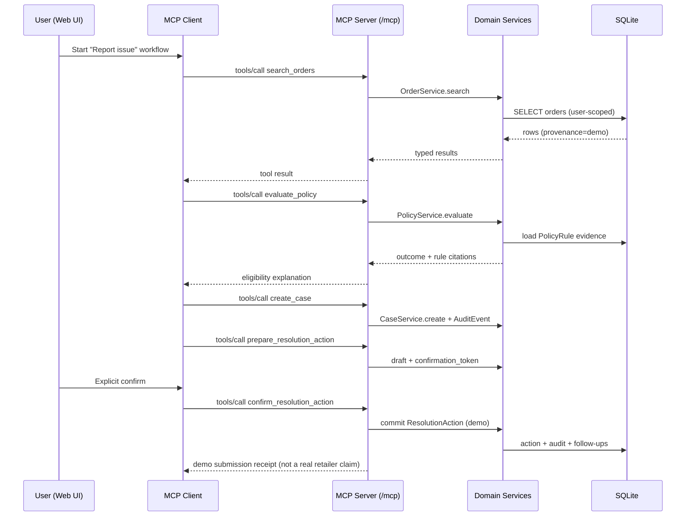
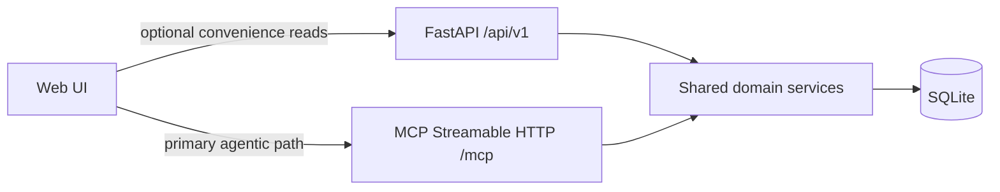

# ReturnRight AI — Architecture

## Components and ports

| Component | Tech | Default | Role |
|-----------|------|---------|------|
| Web app | React + TypeScript + Vite | `:5173` | MCP **client** + UI; persists workflow context in SQLite via tools / local session store |
| API + MCP host | FastAPI + official `mcp` Python SDK | `:8000` | REST under `/api/v1/*`; MCP Streamable HTTP at `/mcp` |
| Database | SQLite | `./data/returnright.db` | Durable orders, policies, cases, audit, follow-ups |
| Docker Compose | API + web (optional nginx) | env-driven | Repeatable demo deploy |

Shared domain services live in `backend/app/services/`. REST routers and MCP tool handlers both call these services. Policy rules are evaluated in **one** place (`PolicyService`).

## Directory structure

```text
ReturnRight AL/
├── docs/                      # Requirements, architecture, backlog, demo, feedback
├── backend/
│   ├── app/
│   │   ├── main.py            # FastAPI host + MCP mount + lifespan
│   │   ├── config.py
│   │   ├── api/               # REST routers
│   │   ├── mcp/               # MCPServer + tool registrations
│   │   ├── db/                # SQLAlchemy engine, session, migrations helper
│   │   ├── domain/            # ORM entities
│   │   ├── schemas/           # Pydantic DTOs
│   │   └── services/          # Orders, policy, cases, confirmation, audit
│   ├── tests/
│   ├── alembic/
│   ├── pyproject.toml
│   └── Dockerfile
├── frontend/
│   ├── src/
│   │   ├── mcp/               # Streamable HTTP MCP client wrapper
│   │   ├── workflow/          # Multi-step agentic workflow state
│   │   ├── components/
│   │   └── pages/
│   ├── package.json
│   └── Dockerfile
├── docker-compose.yml
├── .env.example
└── README.md
```

## Data flow — resolution workflow



## Data flow — REST vs MCP



## MCP tool catalog

| Tool | Consequential? | Purpose |
|------|----------------|---------|
| `get_demo_context` | No | Demo mode flag, user id, provenance notice |
| `search_orders` | No | Search owned sample purchases |
| `get_order` | No | Order + items detail |
| `evaluate_policy` | No | Eligibility + evidence (read-only) |
| `create_case` | Soft | Opens a case + audit event |
| `get_case` / `list_cases` | No | Case detail / list with history |
| `list_follow_ups` | No | Deadlines / tasks for a case |
| `prepare_resolution_action` | No* | Draft + confirmation token (*not committed) |
| `confirm_resolution_action` | **Yes** | Commits demo action after token + approval |
| `update_case` | Soft | Status / notes update with audit |
| `simulate_failure` | No | Intentional failure path; no state corruption |

## Auth / ownership (demo)

- Header `X-User-Id` (REST) and tool arg / session default user id (MCP) identify the demo user.
- All queries filter by `user_id`. Cross-user access returns 404/empty, never other users' data.
- Not production auth — documented as demo boundaries only.

## Persistent agentic context

1. **Server:** `ResolutionCase`, `AuditEvent`, `FollowUpTask`, and pending confirmation tokens in SQLite.
2. **Client:** workflow step, selected order/item, last tool results, and `case_id` in React state + `sessionStorage` so refresh resumes the same step.
3. MCP session uses Streamable HTTP; business continuity does not depend on MCP transport session alone.

## Protocol notes

- Official Python package `mcp` (pinned), `MCPServer` + `streamable_http_app()`.
- Transport: Streamable HTTP (not legacy SSE).
- Host FastAPI lifespan enters `mcp.session_manager.run()`.
- CORS exposes `Mcp-Session-Id` and allows MCP request headers for the Vite origin.
